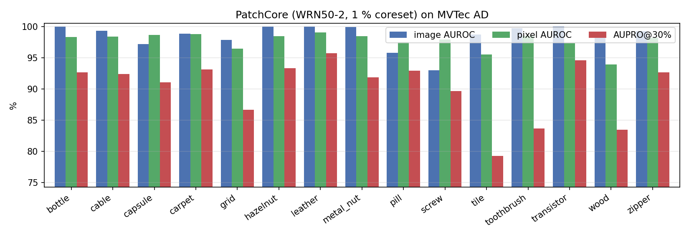
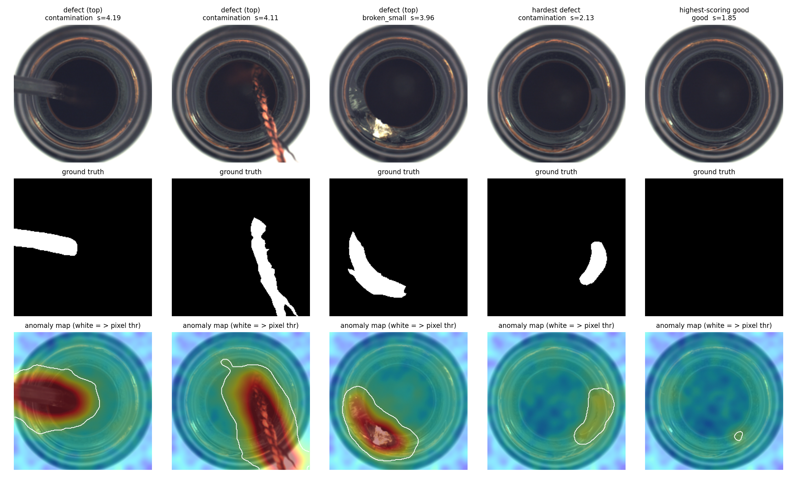
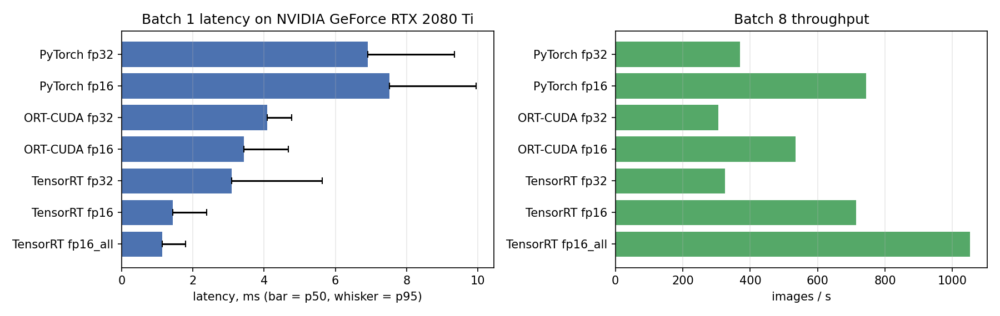

# Industrial Surface-Defect Detection on MVTec AD
### PatchCore → ONNX → TensorRT → FastAPI + Docker, benchmarked on an RTX 2080 Ti

Unsupervised anomaly detection for industrial visual inspection: the model learns only from **defect-free** images and then detects and localises scratches, cracks, contamination and missing parts it has never seen. The project covers the full path from research code to a deployable service:

1. **Model:** a from-scratch, fully exportable PyTorch implementation of PatchCore (Roth et al., CVPR 2022)
2. **Evaluation:** all 15 MVTec AD categories with the standard protocol (image AUROC, pixel AUROC, AUPRO@30 % FPR) plus a deployable, leakage-free decision threshold
3. **Export:** ONNX (fp32 and mixed fp16), verified numerically against PyTorch
4. **Acceleration:** TensorRT 11 engines (strongly typed), benchmarked against PyTorch and ONNX Runtime for **both latency and accuracy**
5. **Serving:** FastAPI service with heat-map output, containerised with Docker; TensorRT engines are built for the target GPU on first start

| Highlight | Value |
|---|---|
| Mean image AUROC (15 categories) | **98.58 %** |
| Mean pixel AUROC / AUPRO@30 % | **97.68 % / 90.17 %** |
| Fit time per category (no gradient training) | 0.6–5.4 s |
| Model latency, batch 1, TensorRT fp16 (p50) | **1.44 ms** (4.8× faster than PyTorch fp32) |
| Throughput, batch 8, TensorRT fp16-all | **1,051 images/s** |
| End-to-end HTTP API, 8 concurrent clients | **144 requests/s**, p95 65 ms |

---

## Contents
- [Results](#results)
  - [Detection and segmentation quality](#1-detection-and-segmentation-quality)
  - [Inference benchmark](#2-inference-benchmark-pytorch-vs-onnx-runtime-vs-tensorrt)
  - [End-to-end latency budget](#3-end-to-end-latency-budget-single-image)
  - [API load test](#4-api-load-test)
- [Method](#method)
- [Repository structure](#repository-structure)
- [Quick start](#quick-start)
- [API reference](#api-reference)
- [Engineering notes](#engineering-notes)
- [Limitations and future work](#limitations-and-future-work)
- [References and licences](#references-and-licences)

---

## Results

All numbers are from a single run of [`notebooks/patchcore_mvtec.ipynb`](notebooks/patchcore_mvtec.ipynb). Raw values are in [`results/`](results/).

**Test environment:** NVIDIA GeForce RTX 2080 Ti (Turing, sm_75, 11 GB), driver 617.42, native Windows, Python 3.10.11, PyTorch 2.14.1+cu126, ONNX Runtime 1.23.2, TensorRT 11.4.0.106. The GPU used was also driving the desktop display, so absolute timings include some interference from the Windows compositor.

### 1. Detection and segmentation quality

Configuration: WideResNet-50-2 (ImageNet), `layer2`+`layer3` features, 1 % greedy coreset, 256→224 centre crop, Gaussian σ = 4.

| Category | Image AUROC | Pixel AUROC | AUPRO@30% | F1 @ thr | FPR @ thr | Memory bank |
|---|---:|---:|---:|---:|---:|---:|
| bottle | 100.00 | 98.31 | 92.65 | 98.44 | 10.00 | 1,474 |
| cable | 99.33 | 98.35 | 92.38 | 98.34 | 0.00 | 1,584 |
| capsule | 97.17 | 98.65 | 91.03 | 96.80 | 17.39 | 1,544 |
| carpet | 98.84 | 98.78 | 93.12 | 94.62 | 32.14 | 1,976 |
| grid | 97.83 | 96.46 | 86.62 | 95.58 | 9.52 | 1,866 |
| hazelnut | 100.00 | 98.43 | 93.27 | 99.28 | 0.00 | 2,760 |
| leather | 100.00 | 99.07 | 95.70 | 88.04 | 78.12 | 1,733 |
| metal_nut | 99.90 | 98.44 | 91.84 | 98.92 | 4.55 | 1,552 |
| pill | 95.80 | 97.47 | 92.89 | 91.67 | 7.69 | 1,882 |
| screw | 92.97 | 97.89 | 89.63 | 89.66 | 21.95 | 2,258 |
| tile | 98.70 | 95.48 | 79.23 | 98.20 | 3.03 | 1,623 |
| toothbrush | 99.72 | 98.48 | 83.65 | 96.77 | 16.67 | 423 |
| transistor | 100.00 | 97.27 | 94.56 | 98.73 | 0.00 | 1,505 |
| wood | 99.12 | 93.92 | 83.42 | 91.60 | 57.89 | 1,740 |
| zipper | 99.26 | 98.19 | 92.63 | 97.87 | 3.12 | 1,693 |
| **mean** | **98.58** | **97.68** | **90.17** | **95.64** | **17.47** | |

All values in %. **F1/FPR @ thr** use the threshold the deployed API uses: the maximum score over 10 % of the *training* images held out as normal, so the test set is never used for calibration. The oracle image F1 (best threshold chosen on the test set, an upper bound only) averages 98.03 %.

**Observations**
- The results are close to the published PatchCore numbers (about 99.0 % image / 98.0 % pixel AUROC for a 1 % coreset). The small gap is consistent with the two simplifications listed under [Method](#method).
- The hardest categories are **screw** (92.97 %) and **pill** (95.80 %): small, rotation-variant objects whose normal appearance varies a lot.
- **Tile, wood and toothbrush** have the lowest AUPRO: anomaly maps detect the defect but under-segment large or thin regions.
- **The threshold-free metrics (AUROC) are much better than the deployed operating point on some textures** (leather FPR 78 %, wood 58 %). A threshold set from only ~20–28 held-out normal images does not generalise well for categories with high natural variation. See [Limitations](#limitations-and-future-work).




### 2. Inference benchmark: PyTorch vs ONNX Runtime vs TensorRT

Category `bottle` (memory bank 1,474 × 1,536). Input: `uint8 [B, 224, 224, 3]` already on the GPU. 50 warm-up and 300 timed iterations, with `torch.cuda.synchronize()` around every iteration. Every backend also re-scores the full test set, so each speed number comes with its accuracy.

| Backend | p50 B=1 (ms) | p95 B=1 (ms) | img/s B=1 | p50 B=8 (ms) | img/s B=8 | Image AUROC | Pixel AUROC | Max rel. score error |
|---|---:|---:|---:|---:|---:|---:|---:|---:|
| PyTorch fp32 (reference) | 6.92 | 9.34 | 139 | 21.51 | 370 | 1.000 | 0.9831 | — |
| PyTorch fp16 | 7.51 | 9.95 | 127 | 10.36 | 744 | 1.000 | 0.9831 | 8.7e-4 |
| ONNX Runtime CUDA fp32 | 4.09 | 4.78 | 239 | 25.97 | 306 | 1.000 | 0.9831 | 1.1e-6 |
| ONNX Runtime CUDA fp16 | 3.44 | 4.68 | 284 | 14.58 | 535 | 1.000 | 0.9831 | 1.0e-3 |
| TensorRT fp32 | 3.08 | 5.63 | 276 | 24.49 | 326 | 1.000 | 0.9831 | 5.4e-6 |
| **TensorRT fp16** (deployed) | **1.44** | **2.39** | **652** | 11.03 | 715 | 1.000 | 0.9831 | 7.6e-4 |
| TensorRT fp16-all | 1.14 | 1.79 | 840 | 7.48 | 1,051 | 1.000 | 0.9831 | 1.5e-2 |

Precision variants: **fp16** = fp16 backbone with an **fp32 nearest-neighbour head**; **fp16-all** = everything in fp16.

**Observations**
- **TensorRT fp16 is 4.8× faster than PyTorch fp32 at batch 1** with a score deviation below 0.1 % and identical AUROC. It is the variant the API serves.
- **fp16-all is another 21 % faster but changes scores 20× more (1.5 %).** The distance computation ‖f‖² − 2f·c + ‖c‖² subtracts nearly equal large numbers, so half precision loses accuracy there. AUROC is unchanged on `bottle`, but `bottle` is already at 100 %, so it is a weak test. The fp32 head was kept for deployment.
- **At batch 8, PyTorch fp16 slightly outperforms TensorRT fp16** (10.36 vs 11.03 ms). The engines were built with the optimisation profile tuned for batch 1, the latency-critical case for inline inspection. A throughput-oriented engine would be built with `opt_batch=8`.
- Turing has fp16 Tensor Cores but no TF32, which is why every fp32 backend stays on plain CUDA cores and gains little from batching.
- The ONNX model and the TensorRT fp32 engine agree with PyTorch to about 1e-6, which confirms the export is exact.



### 3. End-to-end latency budget (single image)

Fastest backend (TensorRT fp16-all), 100 test images, measured inside the notebook process:

| Stage | p50 (ms) | p95 (ms) | Share |
|---|---:|---:|---:|
| PNG decode + resize + crop (CPU) | 19.63 | 20.55 | 82 % |
| Host → device copy | 0.27 | 0.32 | 1 % |
| Inference | 3.79 | 4.20 | 16 % |
| Device → host copy | 0.25 | 0.31 | 1 % |
| **Total** | **23.84** | **25.03** | |

**Image decoding on the CPU dominates, not the GPU.** MVTec images are 900–1024 px PNGs that are resized down to 256 px. In a real inspection line the next optimisation would be GPU decoding (nvJPEG/DALI), uncompressed frames straight from the camera, or capturing at the target resolution.

### 4. API load test

FastAPI + uvicorn (1 worker) serving the TensorRT fp16 engine. Each request uploads one MVTec PNG (multipart) and receives score, decision, defect-area fraction and timings.

| Concurrent clients | Requests/s | p50 (ms) | p95 (ms) |
|---:|---:|---:|---:|
| 1 | 22.3 | 46.6 | 56.8 |
| 4 | 96.0 | 38.9 | 64.2 |
| 8 | 144.1 | 53.6 | 64.6 |

Server-side timing per request: about 19 ms pre-processing plus about 6 ms inference; the rest is HTTP, multipart upload and client overhead. Throughput scales with concurrency because decoding runs in a thread pool in parallel, while GPU inference is serialised through one TensorRT execution context.

**Parity check:** the API's scores match the notebook's PyTorch fp32 scores to within 3e-4 relative error, which confirms the server's pre-processing is identical to training.

---

## Method

**PatchCore in brief.** A frozen ImageNet WideResNet-50-2 produces feature maps from `layer2` (512 ch, 28×28) and `layer3` (1024 ch, 14×14). Each map is smoothed with a 3×3 average pool (local neighbourhood aggregation), `layer3` is upsampled to 28×28, and both are concatenated. Every image therefore gives 784 patch embeddings of dimension 1,536.

- **Memory bank.** The patch embeddings of all normal training images (up to 300k per category) are reduced to 1 % by **greedy k-centre coreset selection**. This approximately minimises the largest distance from any training patch to its nearest kept patch. A Johnson–Lindenstrauss random projection to 128-D makes the selection fast.
- **Scoring.** Each test patch gets a score equal to its distance to the nearest memory-bank entry, computed as ‖f‖² − 2 f·c + ‖c‖², i.e. one matrix multiplication. The image score is the maximum patch score. The anomaly map is the 28×28 score grid, upsampled to 224×224 and Gaussian-smoothed (σ = 4).
- **No gradient training.** "Fitting" a category is one forward pass over its normal images plus the coreset selection: 0.6–5.4 s per category here.

**Simplifications versus the paper:** no neighbourhood re-weighting of the image score, and no adaptive-pool reduction from 1,536 to 1,024 dimensions. Both affect results by a few tenths of a point at most.

**One exportable graph.** Normalisation, backbone, kNN head, upsampling and blur all live in one `nn.Module`. The exported model therefore takes raw `uint8` pixels, which needs 4× less host-to-device bandwidth than float input and leaves no pre-processing logic to keep in sync on the server:

| Tensor | dtype | Shape |
|---|---|---|
| input `image` | uint8 | `[B, 224, 224, 3]` RGB, resized and centre-cropped |
| output `anomaly_map` | float32 | `[B, 1, 224, 224]` |
| output `score` | float32 | `[B]` |

**Thresholds.** 10 % of each category's training images are held out from the memory bank. The image threshold is the maximum held-out score, and the pixel threshold is the maximum held-out anomaly-map value. Both are stored in `meta.json` and used by the API.

---

## Repository structure

```
mvtec-patchcore/
├── notebooks/
│   └── patchcore_mvtec.ipynb    # full pipeline with a step-by-step guide: data → fit → eval → export → TensorRT → benchmark → API test
├── serve/                       # deployable service
│   ├── app/
│   │   ├── main.py              # FastAPI endpoints
│   │   └── inference.py         # pre-processing, TensorRT (CuPy) and ONNX Runtime backends, engine builder, heat-map overlay
│   ├── Dockerfile               # CUDA 13.4 + cuDNN runtime, non-root user, health check
│   ├── docker-compose.yml       # GPU selection, engine-cache volume
│   └── requirements.txt
├── tools/
│   └── build_trt_engine.py      # builds a TensorRT engine in an isolated process
├── results/                     # metrics, benchmark, load-test CSVs and figures from the run above
├── requirements.txt             # training / notebook environment
└── LICENSE
```

Generated at run time and not committed: `artifacts/` (memory banks, ONNX models, TensorRT engines).

---

## Quick start

### Requirements
- NVIDIA GPU with compute capability ≥ 7.5 (Turing or newer); developed on an RTX 2080 Ti
- **NVIDIA driver R580 or newer** (required by the CUDA 13 builds of TensorRT and ONNX Runtime)
- Python 3.10–3.12
- [MVTec AD](https://www.mvtec.com/company/research/datasets/mvtec-ad), downloaded separately (licence: CC BY-NC-SA 4.0)

### 1. Install

```bash
git clone https://github.com/<your-username>/mvtec-patchcore.git
cd mvtec-patchcore
python -m venv .venv
# Windows: .venv\Scripts\activate    Linux: source .venv/bin/activate
pip install -r requirements.txt
```

### 2. Run the notebook

Set the dataset location (folder containing `bottle/`, `cable/`, …) and start Jupyter:

```bash
# Linux / macOS
export MVTEC_ROOT=/path/to/mvtec_ad
# Windows cmd
set MVTEC_ROOT=C:\path\to\mvtec_ad

jupyter lab notebooks/patchcore_mvtec.ipynb
```

On a multi-GPU machine, set `GPU_ID` at the top of the first code cell (index as listed by `nvidia-smi`). The notebook writes everything to `artifacts/`. Approximate run time on an RTX 2080 Ti: 15–20 min for all steps.

### 3. Serve the API

**Without Docker** (Windows cmd example; on Linux use `export`):

```bat
pip install fastapi "uvicorn[standard]" python-multipart cupy-cuda13x
cd serve
set MODEL_DIR=..\artifacts\models
set ENGINE_CACHE=..\artifacts\engines
set BACKEND=trt
set CATEGORIES=bottle
set CUDA_DEVICE_ORDER=PCI_BUS_ID
set CUDA_VISIBLE_DEVICES=0
uvicorn app.main:app --port 8000
```

**With Docker** (requires the NVIDIA Container Toolkit on Linux, or Docker Desktop with the WSL2 backend on Windows):

```bash
cd serve
docker compose build
GPU_ID=0 CATEGORIES=bottle,screw docker compose up -d     # omit CATEGORIES to serve all 15
docker compose logs -f api                                 # wait for "Loaded N categories"
```

The first start builds one TensorRT engine per category (about 1 min each) for the GPU the container runs on. Engines are cached in a Docker volume, so restarts are fast. Interactive API docs: <http://127.0.0.1:8000/docs>

| Variable | Default | Meaning |
|---|---|---|
| `BACKEND` | `trt` | `trt`, `ort-cuda` or `ort-cpu` |
| `PRECISION` | `fp16` | `fp16` (fp16 backbone, fp32 head) or `fp32` |
| `CATEGORIES` | `all` | comma-separated list of categories to load |
| `MAX_BATCH` | `1` | maximum batch size baked into the TensorRT engines |
| `GPU_ID` | `0` | (compose only) GPU index as listed by `nvidia-smi` |

---

## API reference

| Method | Path | Description |
|---|---|---|
| GET | `/health` | Status, backend, runtime version, loaded categories |
| GET | `/categories` | Thresholds and offline metrics per category |
| POST | `/predict/{category}` | Multipart image → JSON result; `?return_heatmap=true` adds a base64 PNG overlay |
| POST | `/predict/{category}/heatmap` | Multipart image → overlay PNG; score in the `X-Anomaly-Score` header |

```bash
curl -F "file=@bottle/test/broken_large/000.png" http://127.0.0.1:8000/predict/bottle
```

```json
{
  "category": "bottle",
  "score": 3.3827,
  "threshold": 1.8,
  "normalized_score": 1.88,
  "is_anomalous": true,
  "defect_area_fraction": 0.031,
  "timing_ms": {"preprocess_ms": 19.7, "inference_ms": 6.1, "total_ms": 33.0}
}
```

(The `threshold`, `normalized_score` and `defect_area_fraction` values above are illustrative; the actual threshold for each category is listed by `/categories`.)

`normalized_score` = score ÷ threshold, so values above 1 mean anomalous. `defect_area_fraction` is the share of pixels above the pixel threshold. Invalid images return 400, unknown categories 404, and oversized uploads 413.

---

## Engineering notes

Problems solved while taking the model from notebook to production, kept here because they are easy to hit:

- **TensorRT 11 only builds strongly typed networks.** `BuilderFlag.FP16` and calibrator-based INT8 were removed, so precision must be expressed in the ONNX graph itself. The project exports separate fp32, mixed-fp16 and all-fp16 graphs, and the same build code works on TensorRT 10 (via the `STRONGLY_TYPED` flag) and 11.
- **A `uint8` network input may only feed a `Cast` in TensorRT.** The model casts first and permutes afterwards (`x.to(float).permute(...)`); the reverse order fails to parse.
- **Mixed precision where it matters.** The kNN distance expansion is numerically fragile in fp16 (catastrophic cancellation), so the deployed model runs the backbone in fp16 and the distance head in fp32. The benchmark quantifies the difference.
- **Engines are not portable.** A TensorRT engine is tied to the GPU architecture and TensorRT version. The container ships ONNX files and builds engines on first start, cached by `category × precision × TensorRT version × GPU name`.
- **Isolated engine builds.** Engines are built in a separate process (`tools/build_trt_engine.py`), so PyTorch's CUDA libraries never sit alongside TensorRT's in one process (a source of hard crashes on Windows), and a native crash cannot take down the Jupyter kernel.
- **Driver and CUDA versions.** The current PyPI builds of TensorRT and ONNX Runtime target CUDA 13 and need driver R580+. With an older driver, TensorRT fails without a Python-level error.
- **Windows specifics.** DataLoader worker processes cannot import functions defined in a notebook, so image loading uses a thread pool. `localhost` resolves to IPv6 first, which adds about 2 s per HTTP connection when uvicorn listens on IPv4 only; use `127.0.0.1`. On a multi-GPU machine, `CUDA_DEVICE_ORDER=PCI_BUS_ID` makes CUDA's GPU numbering match `nvidia-smi`.

---

## Limitations and future work

- **Threshold calibration.** The maximum over ~20–40 held-out normal images is a fragile estimate for textures with high natural variation (leather, wood). Better options: a larger normal validation set, an extreme-value fit of the normal score tail, or per-category false-alarm budgets agreed with the production line.
- **Hard categories.** For screw and pill, test-time augmentation (rotations), higher input resolution, or a stronger backbone (e.g. DINOv2) are standard ways to improve.
- **INT8.** Requires explicit Q/DQ quantisation (e.g. NVIDIA ModelOpt) in TensorRT 11, plus an accuracy check on all categories.
- **Throughput serving.** Dynamic batching (e.g. NVIDIA Triton), batch-8-optimised engines, and GPU image decoding would remove the CPU-decode bottleneck identified above.
- **Benchmark conditions.** The timings were measured on a GPU that also drove the display. A dedicated, clock-locked GPU (`nvidia-smi -lgc`) would give lower and tighter numbers.

---

## References and licences

- K. Roth, L. Pemula, J. Zepeda, B. Schölkopf, T. Brox, P. Gehler. *Towards Total Recall in Industrial Anomaly Detection.* CVPR 2022.
- P. Bergmann, M. Fauser, D. Sattlegger, C. Steger. *MVTec AD — A Comprehensive Real-World Dataset for Unsupervised Anomaly Detection.* CVPR 2019.
- P. Bergmann, K. Batzner, M. Fauser, D. Sattlegger, C. Steger. *The MVTec Anomaly Detection Dataset: A Comprehensive Real-World Dataset for Unsupervised Anomaly Detection.* IJCV 2021 (AUPRO metric).

**Code:** MIT licence (see [LICENSE](LICENSE)).
**Dataset:** MVTec AD is licensed under [CC BY-NC-SA 4.0](https://creativecommons.org/licenses/by-nc-sa/4.0/) and is not included in this repository. Models trained on it inherit its non-commercial restriction.
**Backbone weights:** torchvision ImageNet weights (BSD-3-Clause).

**Author:** Tanvir Hasib, MSc (Information Technology) candidate, Multimedia University, Malaysia
